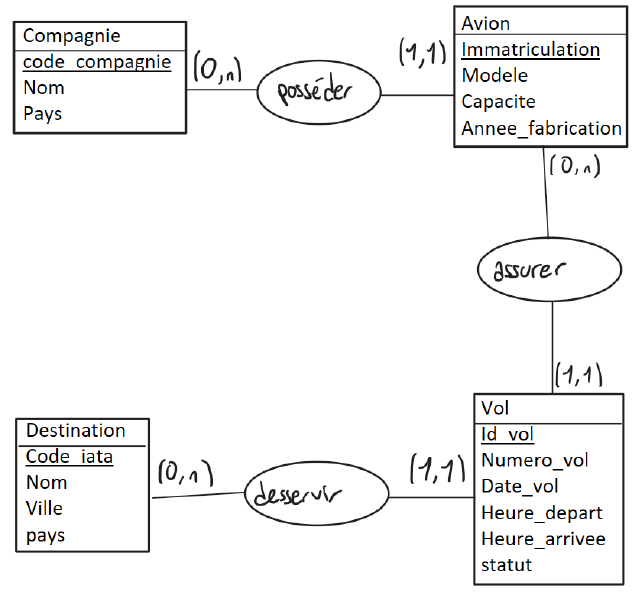

# AéroSud — base de données de gestion des vols

Conception et réalisation d'une **base de données relationnelle SQLite** pour gérer les vols au départ d'un aéroport fictif, AéroSud : compagnies, avions, destinations et vols. Le projet va du modèle conceptuel jusqu'aux tests de validation des contraintes.

Projet individuel réalisé en **Bachelor 2 à l'IPSA** (cours de bases de données).



---

## Le problème

Un aéroport doit savoir à tout moment quel avion assure quel vol, vers quelle destination, et avec quel statut. Les données doivent rester fiables : pas d'avion rattaché à une compagnie inconnue, pas de vol en double, pas d'horaire incohérent.

L'objectif est donc de construire une base où **ces règles sont garanties par la base elle-même** (contraintes SQL), et pas seulement par l'application qui l'utilise.

## Démarche

1. **MCD** (modèle conceptuel de données) : entités, associations et cardinalités
2. **Modèle relationnel** : passage aux tables, clés primaires et clés étrangères
3. **Création** des tables avec leurs contraintes (`sql/01_creation.sql`)
4. **Insertion** d'un jeu de données réaliste (`sql/02_insertion.sql`)
5. **Tests** : 10 cas qui vérifient que chaque règle est bien appliquée (`sql/03_tests.sql`)

## Modèle relationnel

```
COMPAGNIE (code_compagnie, nom, pays)
AVION (immatriculation, modele, capacite, annee_fabrication, #code_compagnie)
DESTINATION (code_iata, nom, ville, pays)
VOL (id_vol, numero_commercial, date_vol, heure_depart, heure_arrivee, statut, #immatriculation, #code_iata)
```

Une compagnie possède 0 à n avions, un avion assure 0 à n vols, une destination est desservie par 0 à n vols.

## Règles de gestion appliquées

| Table | Contraintes |
|---|---|
| **COMPAGNIE** | Code unique de 2 à 3 caractères, nom et pays obligatoires |
| **AVION** | Immatriculation unique, capacité > 0, année de fabrication entre 1950 et 2030 |
| **DESTINATION** | Code IATA unique de 3 lettres majuscules (`GLOB`) |
| **VOL** | Couple (numéro commercial, date) unique, statut limité à *programmé / retardé / annulé / terminé*, formats de date et d'heure contrôlés, arrivée après le départ |
| **Clés étrangères** | `ON DELETE RESTRICT` : impossible de supprimer une compagnie qui a des avions, ou un avion qui a des vols. `ON UPDATE CASCADE` : un changement de code se répercute |

## Jeu de données

4 compagnies (Air France, easyJet, Transavia, Iberia), 7 avions, 6 destinations européennes et 12 vols couvrant les 4 statuts. Les données incluent volontairement des cas limites : une compagnie sans avion, une destination sans vol, un même numéro de vol réutilisé à des dates différentes.

## Tests de validation

| # | Test | Attendu | Résultat |
|---|---|---|---|
| T01 | Ajout d'un avion valide | Accepté | Conforme |
| T02 | Avion rattaché à une compagnie inexistante | Refusé (clé étrangère) | Conforme |
| T03 | Immatriculation en double | Refusé (unicité) | Conforme |
| T04 | Capacité égale à 0 | Refusé (CHECK) | Conforme |
| T05 | Statut « en cours » | Refusé (CHECK) | Conforme |
| T06 | Même numéro de vol à la même date | Refusé (unicité) | Conforme |
| T07 | `PRAGMA foreign_key_check` | Aucune référence orpheline | Conforme |
| T08 | Réouverture du fichier | Données conservées | Conforme |
| T09 | Vol vers une destination inexistante | Refusé (clé étrangère) | Conforme |
| T10 | Suppression d'une compagnie qui a des avions | Refusé (`ON DELETE RESTRICT`) | Conforme |

Le détail des tests avec captures d'écran est dans [`docs/Tests_resultats.pdf`](docs/Tests_resultats.pdf).

## Utiliser la base

La base prête à l'emploi est `aerosud.db`. Pour la recréer à partir des scripts :

```bash
sqlite3 aerosud.db < sql/01_creation.sql
sqlite3 aerosud.db < sql/02_insertion.sql
```

On peut aussi ouvrir les scripts dans **DB Browser for SQLite** (onglet *Exécuter le SQL*).

> SQLite ignore les clés étrangères par défaut : penser à lancer `PRAGMA foreign_keys = ON;` à chaque nouvelle connexion avant les tests.

## Structure

```
aerosud.db                  base SQLite complète
sql/01_creation.sql         création des 4 tables et de leurs contraintes
sql/02_insertion.sql        jeu de données
sql/03_tests.sql            les 10 requêtes de test
docs/MCD.pdf                modèle conceptuel
docs/Modele_relationnel.pdf modèle relationnel
docs/Tests_resultats.pdf    résultats des tests avec captures
```

## Ce que j'ai appris

- Passer d'un besoin métier à un MCD, puis à un modèle relationnel
- Traduire des règles de gestion en contraintes SQL (`PRIMARY KEY`, `UNIQUE`, `CHECK`, `FOREIGN KEY`)
- Choisir le comportement des clés étrangères (`RESTRICT` ou `CASCADE`) selon les besoins
- Écrire des scripts relançables (`INSERT OR IGNORE`, `DROP TABLE IF EXISTS`)
- Tester une base de façon méthodique, en vérifiant aussi ce qui doit être refusé

## Contact

**Timothé Bardoux** — étudiant ingénieur à l'IPSA · [Mon profil GitHub](https://github.com/tbardoux)
